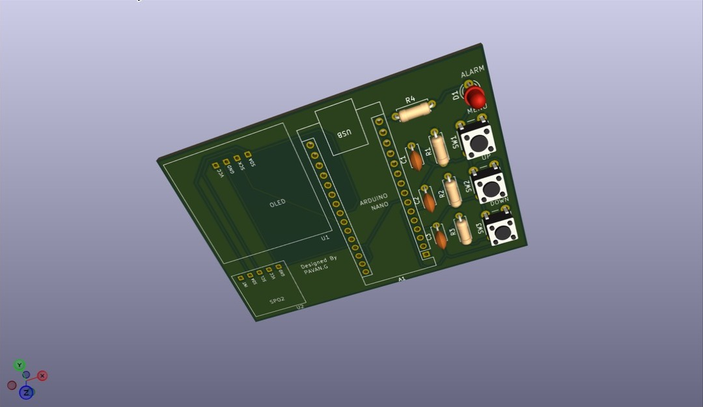
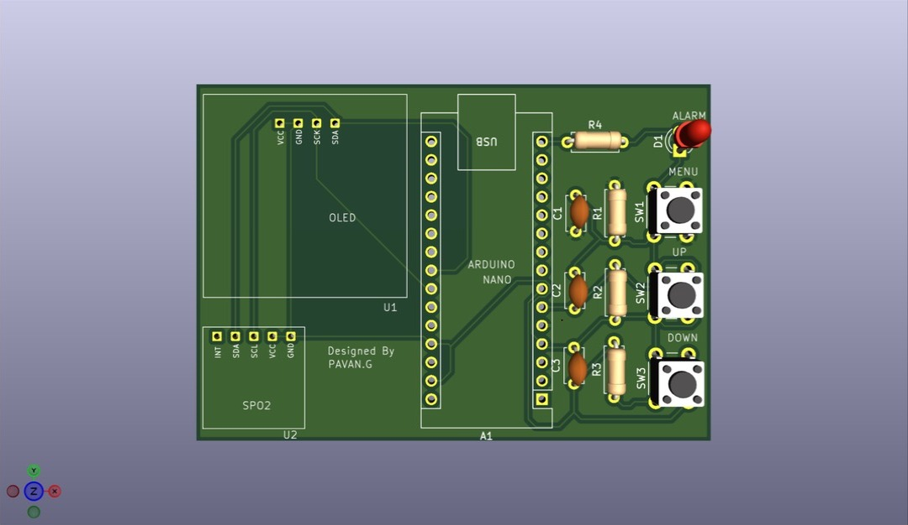
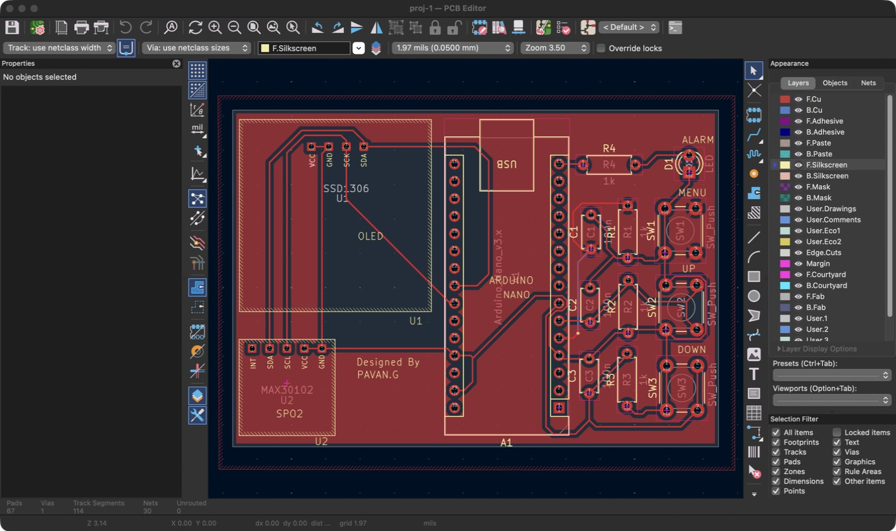
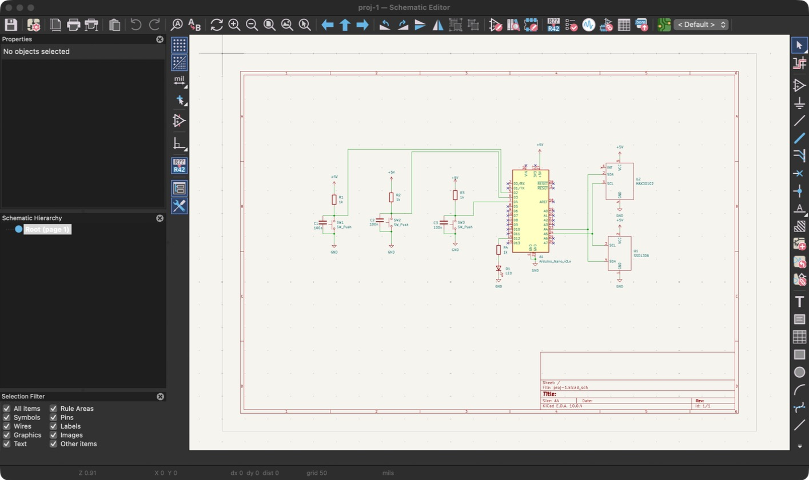

# DIY SpO2 PCB

A two-layer through-hole PCB for a DIY pulse oximeter, designed in KiCad 10. An Arduino Nano reads a MAX30102 sensor module and drives an SSD1306 display.

## 3D view

The Arduino Nano, OLED display and MAX30102 module have no 3D models here, so they appear only as outlines.

## PCB layout

## Schematic

## Parts

| Ref | Part |
| --- | --- |
| A1 | Arduino Nano v3.x |
| U1 | SSD1306 display module |
| U2 | MAX30102 sensor module |
| SW1–SW3 | 6 mm push buttons |
| D1 | 3 mm LED |
| R1–R4 | 1k resistors |
| C1–C3 | 100n capacitors |

## Files

- `proj-1.kicad_pro`, `.kicad_sch`, `.kicad_pcb`: the KiCad project. Open the `.kicad_pro` file in KiCad.
- `spo2_stuff.pretty/`: custom footprints for the MAX30102 and SSD1306 modules.
- `images/`: screenshots of the PCB layout, 3D view and schematic.
- `gerbers/`: fabrication files. `diysp02v1_gerbers.zip` is ready to upload to a PCB manufacturer.
